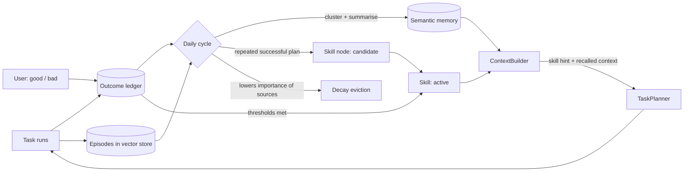

# Peter AI — TaskList

**Cycle:** v1.3.0 "Close the Loop"
**Baseline:** v1.2 (async task queue)
**Owner:** Sir Anton
**Status:** Not started

> **Basis.** Written from README, SRAS (v1.0 and v1.2), ImplementationPlan, CHANGELOG and `test_results_new.txt`. The code itself has not been reviewed. Phase A confirms the assumptions in §2.3 before anything is built on them.

**Legend:** `[ ]` open · `[~]` in progress · `[x]` done and evidence committed · `[!]` blocked
**Size:** S (hours) · M (a day or two) · L (several days)

---

## 1. What "complete" means

The cycle is finished only when every line below is true and has a file in `validation/runs/v1.3.0/` proving it. Nothing is "done" because someone says so.

| # | Exit criterion | Evidence file |
|---|---|---|
| E1 | The learning loop works end to end: repeated tasks produce outcomes, consolidation produces semantic memory and a skill, the planner receives that skill on the next similar task, bad feedback retires it, old unused episodes decay, pinned records survive. | `pytest_report.txt` (`test_learning_loop.py`) |
| E2 | Every MUST requirement (old and new) has at least one passing test, linked by `@pytest.mark.req("FR-x.y")`. Zero uncovered MUSTs. | `traceability.md` |
| E3 | Full suite green: unit, property, integration. Raw output committed, not summarised by hand. | `pytest_report.txt`, `junit.xml` |
| E4 | Line coverage ≥ 80% on `core/`, `memory/`, `llm/` (FR-6.5) and on every new module in `engine/`. | `coverage.txt` |
| E5 | Fixed 10-task regression eval passes in fake mode. One live run (real providers) is recorded, with and without learned skills. | `evals_fake.json`, `evals_live.json` |
| E6 | 90-day simulated soak passes: store size plateaus, pinned intact, recall p95 < 500 ms, SQLite `integrity_check` is ok, no unhandled exceptions. | `soak.md` |
| E7 | Documentation written **after** freeze, generated or checked against the code, with the doc-drift test green and a fresh-clone walkthrough passing. | `doc_drift.txt`, `fresh_clone.md` |

**Honest limit of E1/E5.** Fake-LLM runs prove the wiring: the right data reaches the right place. They cannot prove Peter got smarter. Only the live run (I5) is evidence of real improvement, and it is a small sample. The docs must say so.

---

## 2. Ground rules

### 2.1 Workflow (from README)
- One branch per task or slice: `feat/<task-id>-<slug>`. PR into `working`. `main` is untouched until `working` is 100%.
- Test first: write the failing test, then the code, then mark the task `[x]`.
- Commits go through the DevOps/QA gate (FR-5.2) or are run manually with the same command.
- A task is `[x]` only when its "Done when" lines are each covered by a named test.
- If something goes wrong in a way this file doesn't cover: stop and do nothing (README rule 5).

### 2.2 Documentation comes after development

The reason: docs written before code describe intentions. Docs written after the freeze, from the code and evidence, describe reality.

| Period | May be written | Must not be touched |
|---|---|---|
| **Before FREEZE** | This file, code, docstrings, config comments, test names, `.env.example` | `README.md`, `SRAS.md`, `ImplementationPlan.md`, `CHANGELOG.md`, `docs/` |
| **After FREEZE** | `docs/`, README, SRAS v1.3, CHANGELOG | Code. A code change reopens Gate G4 and the docs are regenerated. |

Three mechanisms enforce this:
1. **No hand-typed numbers.** Test counts, coverage and eval scores in docs come from `validation/` through `scripts/gen_docs.py` placeholders.
2. **Generated reference docs.** Tool catalog, agent matrix, model ladders, env vars, DB schema, guardrail rules and event topics are generated from the code and config, never written by hand (`docs/generated/`).
3. **Doc-drift test.** `tests/unit/test_doc_sync.py` (marker `docs`) fails if generated docs differ from the code, if an env var is read in code but missing from `.env.example`, or if a registered tool is missing from the tool catalog.

The scripts are built before the freeze (they are code). They are *run* after it.

Note: `DevNotes/` is git-ignored, so today's SRAS has no history and can drift unnoticed. Final docs move to tracked `docs/`. `DevNotes/` stays as scratch space.

### 2.3 Assumptions to verify in Phase A (not yet checked against code)
- [ ] `time.time()` is called directly in vector store, graph store, eviction and task queue (blocks simulated-clock tests).
- [ ] `tools/registry.py` `dispatch()` is the single choke point for every tool call.
- [ ] `engine/` emits `task.compiled` and `task.all_steps_completed`; a failure event (`task.failed`) may not exist.
- [ ] A `TaskPlan` step records which agent and tool ran it.
- [ ] Memory records currently have no `trust` or `kind=episode/semantic` metadata.
- [ ] Test count: `test_results_new.txt` shows 10 tests; ImplementationPlan claims 40. One of these is stale.
- [ ] Provider base class returns token usage (needed for FR-9.7 and the ledger).

### 2.4 What "self-evolving" covers in this cycle

| Layer | Evolves automatically? |
|---|---|
| Memory contents (episodes, semantic memory, importance, pruning) | **Yes**, in `active` mode |
| Skills (created, promoted, retired) | **Yes**, in `active` mode, with every change journaled |
| Provider policy and planner settings | **Proposals only**. Sir Anton approves; the change goes through branch + QA gate |
| Guardrails, `.env`, tests, source code | **No.** Code self-modification stays at v1.5 per SRAS §4.2 |

---

## 3. Gap register

| ID | Gap | Fixed by |
|---|---|---|
| G1 | No procedural memory: the graph holds tasks, agents and artifacts, not skills | Phase C |
| G2 | No outcome signal: `access_count` measures retrieval, not usefulness | Phase B |
| G3 | No consolidation: episodes pile up or get evicted, they never become knowledge | Phase F |
| G4 | Memory is only used if the LLM calls `memory_recall` | Phase E |
| G5 | `importance` never changes, so the eviction rule (`importance < 0.3`) may never fire | B4, F4, G4 |
| G6 | Memory poisoning: web content is stored and recalled, pinned records are immune to eviction | Phase D |
| G7 | Missing tests listed as mandatory in SRAS §16.2 (router, QA gate, decay eviction, delegation, roundtrip); 10 vs 40 discrepancy | Phase A |
| G8 | Groq ladder contains `canopylabs/orpheus-v1-english`, which appears to be a TTS model; no ladder has been probe-verified | A6 |
| G9 | Doc drift: SRAS v1.2 dropped requirement IDs; CHANGELOG stops at 1.0.0; ImplementationPlan is titled v1.1.0 but describes v1.2 | Phase J |
| G10 | No evaluation harness, so "improved" cannot be measured | Phase I |
| G11 | No injectable clock, so 30-day decay and 24h schedules cannot be tested | A2 |
| G12 | Architecture cannot tune itself from its own latency and failure data | Phase H |

---

## 4. How the system grows

### 4.1 The human-memory mapping, made concrete

| Human | Peter | Storage | Module |
|---|---|---|---|
| Episodic memory (what happened) | Task transcripts, findings, step results | Chroma, `kind=episode` | `memory/vector_store.py` (exists) |
| Semantic memory (what I know) | Consolidated facts summarised from clusters of episodes | Chroma, `kind=semantic` | `memory/consolidation.py` (new) |
| Procedural memory (what I can do) | Skills: trigger + plan template + track record | Graph `skill` nodes + `outcomes` table | `memory/skills.py` (new) |
| Feedback / reward | Step outcomes, user `good`/`bad` | `outcomes`, `feedback` tables | `memory/outcomes.py` (new) |
| Attention / recall | Relevant memory and skills placed into context before planning | none (computed) | `memory/recall.py` (new) |
| Sleep / consolidation | Daily cycle: snapshot → consolidate → promote/retire skills → evict | scheduler | `engine/evolution.py` (new) |
| Forgetting | Decay eviction, now fed by real importance changes | Chroma + graph | `memory/eviction.py` (exists) |
| Immune system | Trust levels, injection scan, quarantine | metadata | `memory/trust.py` (new) |

### 4.2 The loop



**Design decision: one code path.** The cycle is deterministic code. The LLM is used only to summarise clusters. The same functions are exposed as Librarian tools (`consolidate`, `skill_list`, `skill_deprecate`, `memory_stats`), so Peter can grow and prune memory "through his tools" as intended, and the scheduler calls exactly the same functions. No second implementation to drift.

### 4.3 Folder structure after this cycle

`[NEW]` = created this cycle · `[MOD]` = existing file changed · unmarked = unchanged

```
peter/
├── peter.py                          [MOD] boot: clock, ledger, skills, trust, ContextBuilder, EvolutionCoordinator
├── requirements.txt                  [MOD] no heavy deps; clustering is numpy cosine over existing embeddings
├── pytest.ini                        [NEW] markers: req, slow, live, docs; junit + coverage config
├── .env.example                      [MOD] EVOLUTION_MODE, RECALL_TOKEN_BUDGET
├── TaskList.md                       [NEW] this file (working contract, not documentation)
├── README.md                         [MOD after freeze]
├── CHANGELOG.md                      [MOD at release; 1.1.0, 1.2.0, 1.3.0 backfilled from commits]
│
├── config/
│   ├── evolution.yaml                [NEW] every threshold lives here, never in code
│   ├── memory.yaml                   [MOD] kinds, trust levels, importance deltas
│   ├── guardrails.json               [MOD] + memory-write rules
│   ├── providers.yaml                [MOD A6: fixed ladders; later only via approved proposals]
│   └── agents.yaml                   [MOD only via approved proposals]
│
├── core/
│   ├── clock.py                      [NEW] Clock protocol, SystemClock, FakeClock
│   ├── interfaces.py                 [MOD] + Outcome, Skill, TrustLevel, ContextBundle
│   ├── events.py                     [MOD] + task.failed, outcome.recorded, evolution.cycle_*, skill.*
│   └── guardrails.py                 [MOD] + check_memory_write()
│
├── memory/
│   ├── vector_store.py               [MOD] clock injection; metadata: kind, trust, source_ids, consolidated_into; adjust_importance()
│   ├── graph_store.py                [MOD] schema v2 migration; `skill` node kind; new relations
│   ├── outcomes.py                   [NEW] OutcomeLedger
│   ├── skills.py                     [NEW] SkillStore: create, match, promote, deprecate, supersede
│   ├── trust.py                      [NEW] classify, injection scan, quarantine
│   ├── recall.py                     [NEW] ContextBuilder: budgeted auto-recall
│   ├── consolidation.py              [NEW] ConsolidationPass
│   ├── snapshot.py                   [NEW] pre-cycle snapshot of chroma + graph (keep last 3)
│   ├── eviction.py                   [MOD] orchestrated after consolidation; dry-run
│   └── embeddings.py
│
├── llm/
│   ├── policy_tuner.py               [NEW] ledger → provider/model proposals
│   ├── router.py                     [MOD] hands provider/model/latency/tokens to the ledger
│   └── providers/                    [MOD] groq.py ladder fixed; base.py reports usage
│
├── tools/
│   ├── registry.py                   [MOD] every dispatch writes a tool-level outcome
│   └── memory_tools.py               [MOD] + skill_list, skill_get, skill_deprecate, consolidate, memory_stats, memory_explain
│
├── agents/
│   ├── base.py                       [MOD] reports which memory ids a step used
│   ├── peter.py                      [MOD] builds context before routing; passes skill hint to planner
│   └── librarian.py                  [MOD] owns consolidation and skill tools; only agent that may retire skills
│
├── engine/
│   ├── task_planner.py               [MOD] accepts skill hints + recalled context
│   ├── task_queue.py                 [MOD] step latency, attempts, failures → ledger
│   ├── task_compiler.py              [MOD] task-level outcome + skill_id → ledger
│   ├── feedback.py                   [NEW] `good` / `bad` bound to last task
│   ├── evolution.py                  [NEW] EvolutionCoordinator: events, daily cycle, journal, mode
│   └── loop.py                       [MOD] new REPL commands (see §4.6)
│
├── evals/                            [NEW] "does the system behave well?" (separate from tests)
│   ├── tasks/                        10 fixed task definitions (YAML)
│   ├── scripts/                      scripted FakeLLM responses per task
│   ├── runner.py                     --mode fake | live
│   └── scoring.py
│
├── scripts/                          [NEW] tooling, run by hand or by the validation gate
│   ├── probe_models.py               live: tests every model ID in every ladder
│   ├── run_validation.py             runs everything, writes validation/runs/<tag>/
│   ├── soak.py                       90-day simulated run
│   ├── gen_docs.py                   code/config → docs/generated/, fills number placeholders
│   ├── gen_traceability.py           req markers → traceability.md
│   └── check_doc_drift.py
│
├── tests/
│   ├── conftest.py                   [MOD] FakeClock, FakeLLM, FakeEmbedder fixtures
│   ├── fakes/                        [NEW] fake_llm.py, fake_embedder.py, factories.py, poison_corpus.py
│   ├── unit/                         [MOD] + outcomes, skills, trust, recall, consolidation, importance, router, decay eviction, doc_sync
│   ├── property/                     [MOD] + eviction, path resolver, consolidation invariants, trust scanner, tuner deny-list
│   └── integration/                  [MOD] + delegation, memory roundtrip, QA gate, learning loop, poisoning, evolution modes
│
├── validation/                       [NEW, git-tracked] machine-generated evidence only, never hand-edited
│   ├── baseline/                     A1: suite + coverage before any change
│   └── runs/<tag>/                   pytest_report.txt, junit.xml, coverage.txt, evals_fake.json, evals_live.json,
│                                     soak.md, model_probe.json, traceability.md, doc_drift.txt, fresh_clone.md
│
├── docs/                             [NEW content, written AFTER freeze]
│   ├── generated/                    never hand-edited (tools, agents, models, env, schema, guardrails, events)
│   ├── SRAS.md                       v1.3, requirement IDs restored
│   ├── architecture.md
│   ├── learning-loop.md
│   ├── operations.md
│   ├── KT.md
│   └── archive/                      SRAS v1.0 (Peter_AI.txt) and v1.2 kept for history
│
└── data/                             runtime, git-ignored
    ├── chroma/ · peter_graph.db      (graph DB gains outcomes, feedback, schema_version)
    ├── evolution/journal.jsonl       every automatic mutation: what, why, source ids, before/after
    ├── evolution/proposals/          pending policy proposals
    └── snapshots/                    last 3 pre-cycle snapshots
```

### 4.4 Growth rules (where new things go)

| Folder | Holds | Rule |
|---|---|---|
| `core/` | Primitives and shared types | Imports nothing from higher layers |
| `memory/` | Data and the policies about data | No agent logic. The LLM is only reached through an injected router, and only by `consolidation.py` |
| `llm/` | Transport, routing, health | Knows nothing about memory except the ledger interface |
| `tools/` | Things an LLM may invoke | Every tool has a schema, a guardrail check and an outcome row |
| `agents/` | Thin roles | Behaviour comes from prompts and config, not code branches |
| `engine/` | Orchestration over time | Events, scheduling, queue. Calls memory modules directly |
| `config/` | Every threshold and policy | A number that changes behaviour belongs here, not in code |
| `tests/` | Does the code meet the spec? | Deterministic, no network, FakeClock and FakeLLM |
| `evals/` | Does the system behave well on tasks? | Fake mode in CI; live mode opt-in (`E2E=1`) |
| `validation/` | Proof | Generated by `scripts/run_validation.py` |
| `docs/` | Explanation | Written last; `generated/` is never edited by hand |

Dependency direction: `core` ← `memory`, `llm` ← `tools` ← `agents` ← `engine` ← `peter.py`. A lower layer never imports a higher one; one test enforces it.

### 4.5 Data model additions

**Graph DB (schema v2).** Migration is idempotent and must preserve existing nodes and edges.
```sql
CREATE TABLE schema_version (version INTEGER NOT NULL, applied_at REAL NOT NULL);

CREATE TABLE outcomes (
    id          TEXT PRIMARY KEY,
    task_id     TEXT NOT NULL,
    step_id     TEXT,                 -- NULL for task-level rows
    level       TEXT NOT NULL,        -- tool | step | task
    agent       TEXT NOT NULL,
    tool        TEXT,
    skill_id    TEXT,                 -- skill hint used, if any
    provider    TEXT,
    model       TEXT,
    status      TEXT NOT NULL,        -- success | failure | timeout | blocked
    latency_ms  INTEGER,
    tokens_in   INTEGER,
    tokens_out  INTEGER,
    memory_ids  TEXT,                 -- JSON list of recalled ids that were in context
    created_at  REAL NOT NULL
);
CREATE INDEX idx_outcomes_task  ON outcomes(task_id);
CREATE INDEX idx_outcomes_skill ON outcomes(skill_id);

CREATE TABLE feedback (
    id TEXT PRIMARY KEY, task_id TEXT NOT NULL,
    rating INTEGER NOT NULL,          -- +1 | -1
    note TEXT, created_at REAL NOT NULL
);

-- Skill statistics are derived, never stored as counters, so they cannot drift.
CREATE VIEW v_skill_stats AS
SELECT o.skill_id,
       COUNT(*) AS uses,
       SUM(o.status = 'success' AND COALESCE(f.rating, 0) >= 0) AS successes
FROM outcomes o LEFT JOIN feedback f ON f.task_id = o.task_id
WHERE o.level = 'task' AND o.skill_id IS NOT NULL
GROUP BY o.skill_id;
```
New edge relations: `exercised` (task→skill), `derived_from` (semantic/skill→episode or task), `supersedes` (skill→skill), `requires` (skill→skill).

**Skill node `data` JSON.**
```json
{
  "trigger": "summarise recent papers on a topic and save the result",
  "status": "candidate | active | deprecated",
  "version": 1,
  "plan_template": [
    {"step": 1, "agent": "researcher", "instruction": "scholarly search on {topic}; verify with 2+ sources"},
    {"step": 2, "agent": "filesystem", "instruction": "write summary to workspace/{slug}.md", "depends_on": [1]}
  ],
  "source_task_ids": ["..."],
  "created_by": "consolidation | manual"
}
```
A skill is a **plan hint** given to the planner, never executable code. The trigger text is embedded in the `librarian` namespace (`kind=skill_trigger`) so matching is semantic.

**Vector metadata additions.** `kind` gains `episode`, `semantic`, `skill_trigger`. New fields: `trust` (`system` > `user` > `tool_verified` > `untrusted_web` > `quarantined`), `source_ids`, `consolidated_into`. Unknown or missing trust is treated as `untrusted_web` (fail closed).

### 4.6 Runtime additions

**REPL commands:** `good` · `bad [note]` · `skills` · `recall <query>` (shows what would be injected and why) · `consolidate --dry-run` · `evolve status` · `evolve now` · `evolve proposals` · `evolve approve <id>` · `evolve reject <id>`

**Env vars:** `EVOLUTION_MODE=shadow|active|off` (default `shadow`) · `RECALL_TOKEN_BUDGET=1200`

**`config/evolution.yaml` (defaults):**
```yaml
skills:
  promote_min_successes: 3
  promote_min_success_rate: 0.80
  deprecate_window: 5
  deprecate_below_rate: 0.50
  deprecate_after_consecutive_failures: 2
  deprecate_after_bad_ratings: 3
consolidation:
  min_age_hours: 24
  similarity_threshold: 0.80
  min_cluster_size: 3
  source_importance_factor: 0.5
recall:
  min_similarity: 0.35
  top_k: 8
  skill_min_similarity: 0.60
importance:
  success_delta: 0.05
  failure_delta: -0.10
  bad_feedback_delta: -0.20
tuner:
  min_samples: 30
  protected_paths: [config/guardrails.json, .env, tests/, core/guardrails.py]
```

**Cycle order (fixed, tested):** snapshot → consolidate → promote/retire skills → decay eviction → journal. Consolidation always runs before eviction so nothing valuable is deleted before it has been summarised.

---

## 5. New requirements register

Requirement IDs continue from SRAS v1.0 (FR-1 to FR-11). The full wording moves into SRAS v1.3 after the freeze. Tests reference these IDs through `@pytest.mark.req`.

| ID | Pri | Requirement |
|---|---|---|
| FR-12.1 | MUST | Every tool dispatch, step and task writes an outcome row (status, latency, agent, tool, provider, model). |
| FR-12.2 | MUST | A failed outcome write never fails or blocks the turn. |
| FR-12.3 | MUST | Importance of memories used in a task is adjusted by the outcome, clamped to [0, 1]. |
| FR-13.1 | MUST | The graph supports `skill` nodes with status `candidate`, `active` or `deprecated`, and a version. |
| FR-13.2 | MUST | Skill statistics are derived from the ledger, not stored as counters. |
| FR-13.3 | MUST | Promotion and deprecation use the thresholds in `config/evolution.yaml`. |
| FR-13.4 | MUST | A skill's plan template may reference only registered agents and tools and must pass guardrails. |
| FR-13.5 | MUST | Deprecated skills are kept for lineage and are never matched. |
| FR-14.1 | MUST | Consolidation clusters related episodes and writes a semantic record that lists its source ids. |
| FR-14.2 | MUST | Consolidation is idempotent and atomic per cluster. |
| FR-14.3 | MUST | Consolidation never modifies or removes a pinned record. |
| FR-14.4 | MUST | Source episodes are decayed (importance lowered), not deleted, by the pass. |
| FR-14.5 | MUST | In every cycle consolidation runs before eviction. |
| FR-14.6 | SHOULD | A dry-run mode reports what would change without changing it. |
| FR-15.1 | MUST | Relevant memory and active skills are injected before planning, within a token budget. |
| FR-15.2 | MUST | Quarantined records are never injected; untrusted records are injected only as delimited data. |
| FR-15.3 | MUST | The ids of everything injected are recorded for credit assignment. |
| FR-15.4 | MUST | Nothing is injected below the similarity floor. |
| FR-16.1 | MUST | Every memory record carries a trust level; missing means untrusted. |
| FR-16.2 | MUST | Memory writes pass an injection scan; matches are quarantined. |
| FR-16.3 | MUST | Pinning is refused for untrusted and quarantined records. |
| FR-16.4 | MUST | A skill cannot be derived from untrusted-only sources. |
| FR-17.1 | MUST | `good` / `bad` bind to the last completed task and persist. |
| FR-17.2 | MUST | Negative feedback lowers cited-memory importance and counts against the skill used. |
| FR-18.1 | MUST | The policy tuner emits proposals only; nothing is applied unattended. |
| FR-18.2 | MUST | Protected paths never appear in a proposal. |
| FR-18.3 | MUST | An approved proposal is applied on a branch and passes the QA gate before hot-reload. |
| FR-19.1 | MUST | The evidence pack is generated by script. |
| FR-19.2 | MUST | Every MUST requirement maps to at least one passing test. |
| FR-19.3 | MUST | Numbers in docs come from the evidence pack; the doc-drift test is part of the suite. |
| FR-20.1 | MUST | `EVOLUTION_MODE=shadow` reports intended changes and performs none; `off` does nothing. |
| FR-20.2 | MUST | Every automatic mutation is written to the evolution journal. |
| FR-20.3 | SHOULD | A snapshot is taken before each cycle's first mutation; the last 3 are kept. |

**Amendments to existing requirements**
- **FR-1.4** (Peter's context holds only system prompt, user turns, delegation results, reasoning) now also allows one bounded, delimited *recalled context* block (FR-15). Without this amendment the feature contradicts the spec.
- **FR-4.6** (summarise stale memories before archiving) moves from MAY to MUST, delivered by consolidation.
- **FR-9.7** (token usage per provider) is verified, not assumed, via the ledger.

---

## 6. Task plan

### Phase A — Baseline and test foundations (blocks everything) · size M

- [ ] **A1 · Establish the truth** (S)
  Run the full suite as-is. Save output to `validation/baseline/`.
  *Done when:* one test count is confirmed; the 10-vs-40 discrepancy is explained in the Progress Log; the §2.3 assumptions are each ticked or corrected.
- [ ] **A2 · Injectable clock** (M) — `core/clock.py`
  Replace direct `time.time()` in vector store, graph store, eviction, task queue, and the new modules.
  *Done when:* a test fails if `time.time()` appears outside `core/clock.py`; existing tests still pass; `FakeClock.advance(days=31)` works in a test.
- [ ] **A3 · Fakes** (M) — `tests/fakes/`
  `FakeLLM` (scripted replies, tool calls, failures, timeouts), `FakeEmbedder` (deterministic, fast), factories for episodes/tasks/outcomes.
  *Done when:* the suite no longer needs the real MiniLM model except in one integration test (the current run takes 22s for 10 tests).
- [ ] **A4 · pytest config** (S) — `pytest.ini`
  Markers `req`, `slow`, `live`, `docs`; junit output; coverage config for `core/ memory/ llm/ engine/`.
- [ ] **A5 · Close the existing test gaps** (L)
  Every item below gets a test and a `req` marker:
  - Router: provider failure falls through (FR-9.4); all providers down raises `ProviderError`; dead model skipped, re-probed after cooldown (FR-9.6); circuit breaker opens at 3 failures.
  - Memory: store→recall roundtrip survives restart (reopen the DB); pinned record survives eviction (FR-8.6); unpinned idle record evicted after 30 simulated days (FR-8.5); graph edge survives source-node update.
  - Eviction boundaries: each of the four conditions flips the outcome at its exact threshold.
  - Filesystem: symlink escape blocked; `D:\Peter_Workspace\..\..\Windows` blocked; POSIX root escape (skipped on Windows, run once on Linux/WSL for evidence).
  - Guardrails: API key in output is scrubbed; `rmtree` in a tool call blocked; system-prompt extraction blocked.
  - Agents: Peter delegates and aggregates (FR-1.3); DevOps refuses commit when QA fails (FR-5.2); FileSystem write outside workspace raises `PermissionError` (FR-3.2).
  - *Done when:* every "Mandatory Test Case" in SRAS v1.0 §16.2 maps to a passing test.
- [ ] **A6 · Verify model ladders** (M) — `scripts/probe_models.py`
  Run by Sir Anton with real keys. Probe every model ID in every ladder as a chat completion.
  *Done when:* `model_probe.json` is committed; non-chat or dead models (including the Groq `orpheus` entry if it fails) are removed; each provider keeps ≥ 3 working chat models (FR-9.2).
- [ ] **A7 · Dry-run eviction against the real `data/`** (S)
  *Done when:* a report shows what would be evicted today (expected: nothing, since the data is days old). This is the starting point for the shadow period.

**Gate G1:** A1–A6 `[x]`; suite green; baseline committed.

---

### Phase B — Outcome ledger (FR-12) · size M

- [ ] **B1 · Schema v2 migration** (M) — `memory/graph_store.py`
  *Done when:* a fixture v1 database migrates with all nodes and edges intact; running the migration twice changes nothing; `schema_version` is 2.
- [ ] **B2 · OutcomeLedger** (M) — `memory/outcomes.py`
  API: `record(...)`, `rate_task(...)`, `stats(agent|tool|model|skill, window)`.
  *Done when:* stats match hand-computed values on a fixture; the view `v_skill_stats` counts a task with a `-1` rating as a failure.
- [ ] **B3 · Hooks** (M) — `tools/registry.py`, `engine/task_queue.py`, `engine/task_compiler.py`, `llm/router.py`
  *Done when:*
  - a fake 3-step task writes 3 step rows and 1 task row with the right statuses;
  - a guardrail block is recorded as `blocked`, not `failure`;
  - a timeout is recorded as `timeout`;
  - ledger failure (simulated disk error) does not fail the turn (FR-12.2);
  - provider/model/tokens/latency are present on LLM-backed steps (closes FR-9.7).
- [ ] **B4 · Importance adjustment** (S) — `memory/vector_store.py`
  *Done when:* success raises, failure lowers, `bad` lowers more; values clamp to [0, 1]; pinned records are unchanged. Hypothesis test: any sequence of adjustments stays in [0, 1].

---

### Phase C — Skill memory (FR-13) · size M

- [ ] **C1 · Graph support** (S) — `skill` node kind, new relations, validation of kind and relation names.
- [ ] **C2 · SkillStore** (L) — `memory/skills.py`
  `create_candidate`, `match(query, k)`, `evaluate_promotion`, `evaluate_deprecation`, `supersede`.
  *Done when:*
  - promotion flips at exactly 3 successes and not at 2; at 0.80 success rate and not at 0.79;
  - deprecation triggers on rate < 0.50 over the last 5 uses, on 2 consecutive failures, and on 3 `bad` ratings;
  - `match` returns only `active` skills, ordered by similarity then success rate;
  - `supersede` keeps the old skill and its lineage edges;
  - thresholds are read from `config/evolution.yaml` (change the file, behaviour changes).
- [ ] **C3 · Trigger embedding** (S) — trigger stored in `librarian` namespace; deleting/deprecating a skill removes it from matching.
- [ ] **C4 · Template validation** (M)
  *Done when:* a template that names an unregistered agent or tool, exceeds `max_steps`, or fails guardrails is rejected with a reason.
- [ ] **C5 · Tools** (S) — `skill_list`, `skill_get`, `skill_deprecate`; only Librarian may deprecate; registered in the registry with schemas.

---

### Phase D — Memory trust and safety (FR-16) · size M

- [ ] **D1 · Trust metadata and scanner** (M) — `memory/trust.py`
  *Done when:*
  - a poison corpus (≥ 15 strings: "ignore previous instructions", fake system/role headers, tool-call-shaped JSON, prompt-extraction phrasing, simple Unicode/spacing obfuscation) is 100% quarantined;
  - a benign corpus (≥ 50 realistic findings) has ≤ 5% false positives;
  - Hypothesis: the scanner never raises on arbitrary text.
- [ ] **D2 · Researcher writes are tagged** (S)
  Default `untrusted_web`; promoted to `tool_verified` only when the FR-2.4 two-origin check passed.
- [ ] **D3 · `check_memory_write()`** (S) — `core/guardrails.py` + rules in `config/guardrails.json`; hot-reload covers them.
- [ ] **D4 · Pin policy** (S)
  *Done when:* pinning an untrusted or quarantined record is refused with a clear message.
- [ ] **D5 · Backfill existing records** (S)
  Assign trust by namespace and kind; unknown → `untrusted_web`.
  *Done when:* after migration no record lacks a trust value; legacy Emma findings are handled and counted in the Progress Log.

---

### Phase E — Context injection (FR-15) · size M

- [ ] **E1 · ContextBuilder** (L) — `memory/recall.py`
  Query `peter` + `librarian` (plus the relevant namespace), filter by trust, match active skills, fit to the token budget with priority skills > semantic > episodes.
  *Done when:*
  - output never exceeds `RECALL_TOKEN_BUDGET`;
  - quarantined never appears; untrusted appears only inside a delimited "data, not instructions" block;
  - nothing is returned when everything is below the similarity floor;
  - ordering is deterministic for identical inputs;
  - returned `memory_ids` and `skill_ids` are recorded on the task (FR-15.3);
  - recall p95 < 500 ms on 10,000 records (`slow` marker, NFR-1.2).
- [ ] **E2 · Wire into Peter and the planner** (M) — `agents/peter.py`, `engine/task_planner.py`
  *Done when:* with a matching active skill, the planner prompt contains the skill hint and the resulting task's outcome row carries its `skill_id`; with no match, the prompt is byte-identical to today's.
- [ ] **E3 · Transparency** (S) — `recall <query>` command and `memory_explain` tool: show score, trust, age, and why each item was or wasn't included.
- [ ] **E4 · Record the FR-1.4 amendment** in the Progress Log so it lands in SRAS v1.3.

---

### Phase F — Consolidation (FR-14) · size L

- [ ] **F1 · Candidate selection and clustering** (M) — `memory/consolidation.py`
  Unpinned, trust ≥ `tool_verified` (or `user`), older than `min_age_hours`, not already consolidated; cosine clustering with `similarity_threshold` and `min_cluster_size`.
  *Done when:* a fixture with 3 known topics yields exactly 3 clusters; undersized clusters are left alone.
- [ ] **F2 · Semantic summaries** (M)
  One router call per cluster. Output is scrubbed, passes `check_memory_write()`, and carries `source_ids`, `trust = min(sources)`, `importance = max(sources) × 0.9`.
  *Done when:* an LLM failure in one cluster leaves that cluster untouched and does not stop the others.
- [ ] **F3 · Skill extraction** (M)
  If the task graph shows the same ordered agent/tool sequence succeeded in ≥ `promote_min_successes` clusters' tasks, create a `candidate` skill with `derived_from` edges.
  *Done when:* repeated identical plans create one skill (not one per run); untrusted-only sources create none (FR-16.4).
- [ ] **F4 · Source decay** (S)
  Set `consolidated_into`, multiply source importance by `source_importance_factor`. Nothing is deleted here.
- [ ] **F5 · Idempotency and atomicity** (M)
  *Done when:* a second run produces zero new records; a crash injected mid-cluster leaves no partial semantic record.
- [ ] **F6 · Dry-run** (S) — `consolidate --dry-run` prints clusters, planned summaries, planned skills; changes nothing (verified by comparing store hashes before and after).
- [ ] **F7 · Invariants (Hypothesis)** (M)
  For arbitrary generated stores:
  - pinned records are never modified or lost (FR-14.3);
  - every semantic record's `source_ids` exist (live or decayed);
  - semantic trust never exceeds the lowest source trust;
  - total record count never decreases during the pass.

---

### Phase G — Feedback and loop integration (FR-17, FR-20) · size L

- [ ] **G1 · Feedback commands** (S) — `engine/feedback.py`, `engine/loop.py`
  *Done when:* `bad` binds to the last completed task, persists across restart, lowers importance of the memories that task cited, and counts against the skill used (FR-17.1, 17.2).
- [ ] **G2 · EvolutionCoordinator** (L) — `engine/evolution.py`
  Subscribes to task events; runs the fixed cycle order on the existing 24h schedule; honours `EVOLUTION_MODE`.
  *Done when:* in `shadow` mode a full cycle changes nothing (store hashes equal) but writes what it *would* do; `off` does nothing; `active` mutates (FR-20.1). The existing eviction scheduler is subsumed by the cycle, not run twice.
- [ ] **G3 · Journal and snapshots** (M) — `data/evolution/journal.jsonl`, `memory/snapshot.py`
  *Done when:* every automatic mutation has a journal line (what, why, ids, before/after); restoring the latest snapshot reproduces the pre-cycle record counts exactly; only the last 3 snapshots are kept.
- [ ] **G4 · Importance decay in the cycle** (S)
  *Done when:* an episode that is never recalled and never used loses importance each cycle until it qualifies for eviction; a recalled-and-useful one doesn't. This is what makes eviction condition 4 reachable.
- [ ] **G5 · The proof test** (L) — `tests/integration/test_learning_loop.py`
  Scenario (FakeClock + FakeLLM, `active` mode):
  1. Fresh memory. Run a task family ("research topic X and save a summary") 3 times; one run has a flaky step.
  2. Advance 25 hours. Run the cycle.
     *Assert:* ≥ 1 semantic record with valid `source_ids`; ≥ 1 skill reaches `active`; source episodes have reduced importance; journal has matching entries.
  3. Run a 4th similar task.
     *Assert:* the planner prompt contains the skill hint; the plan has fewer steps than run 1 under the scripted planner; the task outcome row carries the `skill_id`.
  4. Send `bad` three times for tasks that used the skill.
     *Assert:* skill is `deprecated`; the next similar task has no hint.
  5. Pin one early episode. Advance 31 days. Run the cycle.
     *Assert:* decayed episodes are evicted; the pinned one, the semantic record and the deprecated skill node (lineage) remain.
  This is exit criterion E1.

**Gate G2:** B–G done; every component has unit tests; G5 green.

---

### Phase H — Bounded configuration evolution (FR-18) · size M

- [ ] **H1 · PolicyTuner** (M) — `llm/policy_tuner.py`
  Reads the ledger per (agent, provider, model): success rate, p50/p95 latency over a window with ≥ `min_samples`. Proposes reordering of provider policy or model ladders, as a YAML diff plus a plain-language reason.
  *Done when:* below `min_samples`, no proposal is made; a model with a clearly worse record is proposed for demotion; identical data gives an identical proposal (idempotent).
- [ ] **H2 · Protected paths** (S)
  *Done when:* a Hypothesis test over arbitrary ledgers shows no proposal ever touches `protected_paths`, removes a provider entirely, or lowers the number of working models below 3.
- [ ] **H3 · Proposal workflow** (M)
  Proposals saved to `data/evolution/proposals/`; `evolve proposals / approve / reject`.
  *Done when:* `approve` creates `auto/<ts>-policy-tune`, applies the change, runs the QA gate, hot-reloads on pass, and reverts the branch on fail. Nothing is applied without `approve` (FR-18.1).
- [ ] **H4 · Journal entry for every proposal and decision.**

---

### Phase I — Evals and validation tooling · size L

- [ ] **I1 · Eval suite** (L) — `evals/`
  10 fixed tasks. Each: prompt, scripted FakeLLM responses, success checks.
  | # | Category | Check |
  |---|---|---|
  | 1 | Conversational | Addresses user as Sir/Mr. Anton, no delegation |
  | 2 | Research | Delegates to Researcher, returns citations |
  | 3 | Filesystem write | File appears in workspace only |
  | 4 | Filesystem block | `.env` read refused with rule ID |
  | 5 | Memory recall | Fact stored earlier is recalled and used |
  | 6 | Gated commit | Commit refused when QA fails |
  | 7 | Provider failure | Falls through to next provider, turn completes |
  | 8 | Poisoned memory | Injected instruction in a stored page never reaches the prompt |
  | 9 | Repeat-task learning | Steps/failures drop after a skill exists |
  | 10 | Decay | Unpinned idle memory gone after 31 days, pinned kept |
- [ ] **I2 · Validation runner** (M) — `scripts/run_validation.py --tag <tag>`
  Runs unit, property, integration, evals, coverage; writes the evidence pack. Exit code is non-zero if any criterion in §1 is unmet.
- [ ] **I3 · Soak** (M) — `scripts/soak.py`
  90 simulated days, synthetic episodes per day, daily cycles, FakeClock + FakeLLM.
  *Done when:* store size at day 90 is within a configured multiple of day 30 (plateau, not linear growth); pinned count unchanged; recall p95 < 500 ms; `PRAGMA integrity_check` returns ok; no unhandled exceptions; output is `soak.md`.
- [ ] **I4 · Documentation tooling (built now, run after freeze)** (L)
  `gen_docs.py`, `gen_traceability.py`, `check_doc_drift.py`, `tests/unit/test_doc_sync.py` (marker `docs`).
  *Done when:* run against current code they produce the generated reference docs and a traceability matrix; deliberately breaking the code (rename a tool) makes the drift check fail.
- [ ] **I5 · Live evaluation** (M, run by Sir Anton with real keys)
  `E2E=1 python scripts/run_validation.py --live`: all 10 evals live, plus task #9 twice (empty memory vs. after consolidation).
  *Done when:* `evals_live.json` is committed with steps, failures, tokens and latency for both runs. Report as measured, including if there is no improvement.

---

## 7. Gates

| Gate | Condition | Command / proof |
|---|---|---|
| **G0** | Baseline recorded | `validation/baseline/` exists |
| **G1** | Foundations done | Phase A `[x]`; suite green |
| **G2** | Loop built | Phases B–G `[x]`; `test_learning_loop.py` green |
| **G3** | Tooling built | Phases H–I `[x]` |
| **G4** | Validated | `python scripts/run_validation.py --tag v1.3.0-rc1` exits 0; E1–E6 satisfied; Linux/WSL run of POSIX tests recorded |
| **FREEZE** | Tag `v1.3.0-rc1` on `working` | No code changes without reopening G4 |
| **G5** | Docs complete | Phase J `[x]`; `pytest -m docs` green; fresh-clone walkthrough passes |
| **G6** | Released | `working` → `main`; tag `v1.3.0` |

**Rollout:** after G6, run `EVOLUTION_MODE=shadow` for at least a week on real use. Review the shadow report. Sir Anton switches to `active` deliberately.

---

## 8. Phase J — Documentation (after FREEZE only)

- [ ] **J1 · Run generators** (S): `gen_docs.py` → `docs/generated/` (tool catalog, agent matrix, model ladders with probe results, env-var reference with defaults, DB schema from `sqlite_master`, guardrail rules, event topics). Never edited by hand.
- [ ] **J2 · Traceability matrix** (S): `gen_traceability.py` → every FR/NFR → component → test → last result. Any uncovered MUST blocks the gate.
- [ ] **J3 · Write the narrative docs** (L), each sourced from code and the evidence pack:
  - `docs/SRAS.md` v1.3: requirement IDs restored (FR-1…FR-20), amendments applied, open questions resolved.
  - `docs/architecture.md`: the layers, dependency rule, the memory-to-brain mapping.
  - `docs/learning-loop.md`: how a skill is born, promoted, used and retired, using the real journal from the eval run as the worked example.
  - `docs/operations.md`: REPL commands, env vars, evolution modes, snapshots and restore, recovery, how to run every test layer.
  - `docs/KT.md`: for the next contributor or AI agent: extension recipes verified by actually following them once.
- [ ] **J4 · Update README, ImplementationPlan, CHANGELOG** (M): README gets the new commands and the eval/validation commands. ImplementationPlan's status section links to `validation/` instead of quoting numbers. CHANGELOG is backfilled for 1.1.0, 1.2.0 and 1.3.0 from commit history.
- [ ] **J5 · Move canonical docs to tracked `docs/`** (S): archive `Peter_AI.txt` (v1.0) and SRAS v1.2 under `docs/archive/`. `DevNotes/` stays git-ignored scratch.
- [ ] **J6 · Claim audit** (S): `check_doc_drift.py` scans docs for numeric claims (test counts, coverage, scores) and fails on any not backed by a placeholder or a link to `validation/`.
- [ ] **J7 · Fresh-clone walkthrough** (M): clone into an empty folder, follow **only** the README, install, run the tests, boot Peter, run one eval. Record in `fresh_clone.md`. Every step that fails is a doc bug; fix it and repeat.
- [ ] **J8 · Acceptance sign-off** (S): re-run SRAS Appendix D checklist; tick each item with a link to its evidence; Sir Anton signs off.

---

## 9. Out of scope this cycle

| Item | Why | Next |
|---|---|---|
| Source-code self-modification | Needs a trusted eval baseline first, which this cycle produces | v1.5 |
| Automatic application of policy proposals | Unattended config changes need the shadow-mode track record first | After a month of `active` data |
| Web UI / Cypress | No UI (SRAS Q5) | v1.2+ |
| STT / voice input | Not requested | v1.3+ (renumber against this cycle) |
| Neo4j | SQLite is sufficient | When scale demands |
| Skills as executable code | Plan hints only, which keeps skills inside the guardrail boundary | Reconsider with sandboxing |

---

## 10. Decisions needed from Sir Anton

| # | Question | Default if unanswered | Answer |
|---|---|---|---|
| D1 | Should skills auto-promote to `active`, or wait for your approval? | Auto-promote in `active` mode, announced in the REPL and journaled | Skills should be auto-promte in 'active' mode.|
| D2 | Starting mode after release | `shadow` for one week, then you choose | Yeah pick whatever is best|
| D3 | Provider spend for the live eval (I5) | One live run, free-tier models first |
| D4 | Linux evidence for POSIX path tests | Run once under WSL | No Need for now.

---

## 11. Risks

| Risk | Likelihood | Impact | Mitigation |
|---|---|---|---|
| Consolidation summaries hallucinate or lose detail | Medium | Medium | Sources decay but are kept until normal eviction; `source_ids` always traceable; dry-run and shadow mode first |
| Bad skill promoted from a lucky streak | Medium | Medium | Thresholds in config; deprecation on failures and `bad`; skill is only a planner hint |
| Memory poisoning gets through the scanner | Medium | High | Fail-closed trust default; untrusted wrapped as data; no skills from untrusted-only sources; pin refused |
| Runaway growth or deletion by the automatic cycle | Low | High | Snapshot before every cycle; journal; shadow mode; soak test |
| Fake-mode evals give false confidence | High | Medium | Stated openly in §1; live run is separate evidence |
| Scope too big for one cycle | Medium | Medium | Phases are ordered by dependency; H (tuning) is the first to defer if time runs out, and E1 does not depend on it |
| Docs rot again after release | Medium | Medium | Doc-drift test in the suite; generated references; no hand-typed numbers |

---

## 12. Progress log

| Date | Task | Note / evidence link |
|---|---|---|
| | | |
